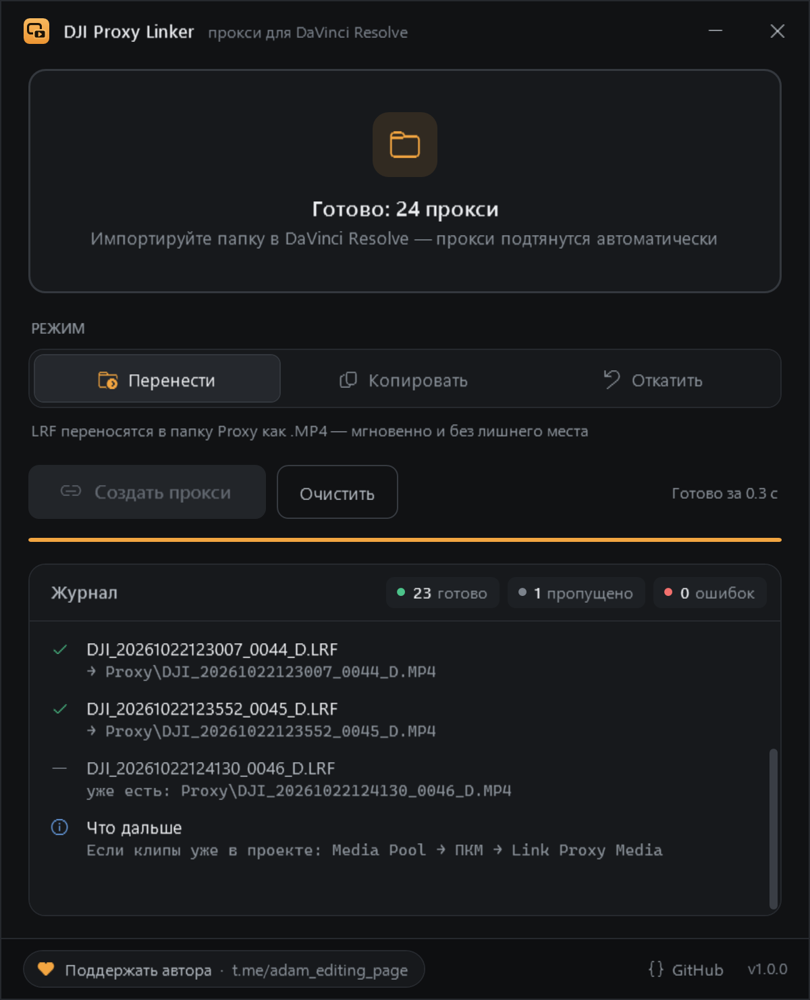

<div align="center">


# DJI Proxy Linker

**Готовые прокси с DJI Pocket / Osmo / дронов — в DaVinci Resolve за один клик**

[](LICENSE)


[](https://t.me/adam_editing_page)



[Русский](#зачем) · [English](#english)

</div>

## Зачем

Камеры DJI (Pocket 3, Osmo Action, Avata, Mini и др.) **уже пишут прокси** рядом с каждым видео — это файлы `.LRF`.
Но DaVinci Resolve их не понимает из-за расширения. Если переименовать `.LRF` → `.MP4` и положить в подпапку `Proxy`,
Resolve **сам подцепит их как прокси** — и не нужно тратить время на генерацию своих.

DJI Proxy Linker делает это автоматически для любого количества папок:

```
DJI_001\
├── DJI_20261022121502_0041_D.MP4        ← оригинал
├── DJI_20261022121502_0041_D.LRF   ─┐
└── Proxy\                           │  перенос + переименование
    └── DJI_20261022121502_0041_D.MP4 ◄┘  ← прокси для Resolve
```

## Возможности

- **Перетащите** папки (хоть всю карту `DCIM`) в окно или на значок `.exe` — подпапки обрабатываются рекурсивно
- **Три режима:** перенести (мгновенно, без лишнего места) · скопировать (LRF остаются на месте) · откатить обратно в `.LRF`
- Расширение прокси совпадает с исходником (`.MP4` / `.MOV`), чтобы Resolve точно сопоставил имена
- Повторный запуск безопасен: уже готовые прокси пропускаются
- **ПКМ по папке → «Создать прокси для DaVinci»** — без открытия программы (ставится установщиком)
- Около 100 КБ, работает на встроенном в Windows .NET Framework 4.8 — ничего доустанавливать не нужно

## Установка

Скачайте со страницы [последнего релиза](https://github.com/blemb666/dji-proxy-linker/releases/latest):

| Файл | Для кого |
|---|---|
| `DjiProxyLinker-Setup-x.y.z.exe` | **рекомендуется** — ярлык в «Пуске», пункт в контекстном меню папок и дисков, ярлык в «Отправить», удаление через «Приложения». Права администратора не нужны |
| `DjiProxyLinker.exe` | portable — один файл, без установки |

> Windows может показать «Система Windows защитила ваш компьютер», потому что файлы пока не подписаны.
> Нажмите **Подробнее → Выполнить в любом случае**. Исходный код целиком открыт в этом репозитории.

## Как пользоваться

1. Скопируйте видео с карты на диск.
2. Нажмите правой кнопкой по папке → **«Создать прокси для DaVinci»**.
   Или перетащите папку в окно программы и нажмите **«Создать прокси»**.
3. Импортируйте папку в DaVinci Resolve — прокси подтянутся автоматически.
   Если клипы уже были в проекте: **Media Pool → ПКМ по клипам → Link Proxy Media** и укажите папку.

> В Windows 11 пункт находится в **«Показать дополнительные параметры»** (или `Shift+F10`) —
> новое компактное меню закрыто для обычных программ.
> Чтобы обработать сразу несколько папок, выделите их и используйте **Отправить → DJI Proxy Linker**.

**Горячие клавиши:** `Ctrl+O` — выбрать папки · `Enter` — запустить · `Esc` — очистить.

### Командная строка

```
DjiProxyLinker.exe [--copy | --undo] [--run] <папки или файлы...>
```

| Флаг | Что делает |
|---|---|
| `--copy` | копировать LRF вместо переноса |
| `--undo` | вернуть `Proxy\*.MP4` обратно в `*.LRF` |
| `--run` | сразу запустить обработку, без нажатия кнопки |

## Сборка

Нужна только Windows 10/11 — компилятор C# уже встроен в .NET Framework.

```powershell
powershell -ExecutionPolicy Bypass -File build.ps1 -Version 1.2.3            # только exe
powershell -ExecutionPolicy Bypass -File build.ps1 -Version 1.2.3 -Installer # + установщик
```

Результат — в `dist\`. Для установщика нужен [Inno Setup 6](https://jrsoftware.org/isdl.php).

**Релизы собираются автоматически** в GitHub Actions: достаточно отправить тег —
`git tag v1.2.3 && git push origin v1.2.3`. Через пару минут на странице Releases появятся
установщик и portable-exe с контрольными суммами. Тестовая сборка без релиза:
Actions → Build → Run workflow.

| Файл | Что внутри |
|---|---|
| `src/Linker.cs` | поиск LRF и перенос/копирование/откат |
| `src/App.cs` | окно, перетаскивание, журнал, аргументы командной строки |
| `src/MainWindow.xaml` | разметка и стили интерфейса (WPF) |
| `src/Icon.xaml` | векторная иконка, при сборке рендерится в `.ico` |
| `src/FolderPicker.cs` | современный диалог выбора нескольких папок |
| `installer/DjiProxyLinker.iss` | установщик Inno Setup и пункт контекстного меню |
| `.github/workflows/release.yml` | сборка и публикация релизов по тегу |

## Поддержать

Проект развивается при поддержке **Adam Editing** — монтаж, цветокор и всё про DaVinci Resolve:

<a href="https://t.me/adam_editing_page"></a>

Подписывайтесь, ставьте ⭐ репозиторию и присылайте идеи в [Issues](https://github.com/blemb666/dji-proxy-linker/issues).

---

## English

**DJI Proxy Linker** turns the `.LRF` low-res files that DJI cameras record next to every clip into proxies DaVinci Resolve picks up automatically.
It moves (or copies) each `NAME.LRF` to `Proxy\NAME.MP4` next to the original, so Resolve links it on import — no proxy rendering needed.

- Drag & drop folders onto the window or the `.exe`; subfolders are processed recursively
- Modes: move (instant), copy, undo
- Installer adds a "Create proxies for DaVinci" item to the folder context menu; a portable exe is also available
- ~100 KB, runs on the .NET Framework 4.8 that ships with Windows 10/11
- Releases are built by GitHub Actions on every `v*.*.*` tag
- Build: `powershell -ExecutionPolicy Bypass -File build.ps1`

Sponsored by [Adam Editing on Telegram](https://t.me/adam_editing_page).

## Лицензия

[Apache License 2.0](LICENSE). Проект не связан с DJI и Blackmagic Design; названия принадлежат их владельцам.
