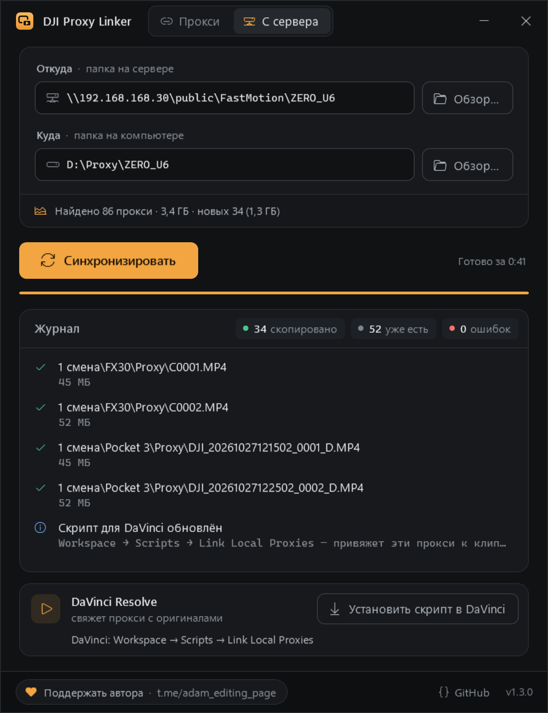

<div align="center">


# DJI Proxy Linker

**Готовые прокси с DJI Pocket / Osmo / дронов и камер Sony — в DaVinci Resolve за один клик**

[](LICENSE)


[](https://t.me/adam_editing_page)


[Русский](#зачем) · [English](#english)

</div>

## Зачем

Камеры DJI (Pocket 3, Osmo Action, Avata, Mini и др.) **уже пишут прокси** рядом с каждым видео — это файлы `.LRF`.
Но DaVinci Resolve их не понимает из-за расширения. Если переименовать `.LRF` → `.MP4` и положить в подпапку `Proxy`,
Resolve **сам подцепит их как прокси** — и не нужно тратить время на генерацию своих.

DJI Proxy Linker делает это автоматически для любого количества папок:

```
DJI_001\
├── DJI_20261022121502_0041_D.MP4        ← оригинал
├── DJI_20261022121502_0041_D.LRF   ─┐
└── Proxy\                           │  перенос + переименование
    └── DJI_20261022121502_0041_D.MP4 ◄┘  ← прокси для Resolve
```

### Камеры Sony

Камеры Sony с включённой записью прокси (α7 IV, α7S III, FX3, FX30, ZV-E1 и др.) кладут прокси в отдельную папку
`SUB` с суффиксом `S03` в имени. Программа переносит их в `CLIP\Proxy` под именем исходника:

```
PRIVATE\M4ROOT\
├── CLIP\
│   ├── C0001.MP4                  ← оригинал
│   └── Proxy\
│       └── C0001.MP4  ◄─┐         ← прокси для Resolve
└── SUB\                 │  перенос + переименование
    └── C0001S03.MP4  ───┘
```

Прокси без исходника в `CLIP` не трогаются. Откат возвращает файлы обратно в `SUB` с прежними именами.

## Возможности

- **Перетащите** папки (хоть всю карту `DCIM` или `PRIVATE`) в окно или на значок `.exe` — подпапки обрабатываются рекурсивно
- **DJI и Sony** на одной карте или в одной папке проекта — распознаются автоматически
- **Три режима:** перенести (мгновенно, без лишнего места) · скопировать (прокси остаются на месте) · откатить обратно
- Расширение прокси DJI совпадает с исходником (`.MP4` / `.MOV`), чтобы Resolve точно сопоставил имена
- Служебные файлы macOS (`._*`) на картах игнорируются
- Повторный запуск безопасен: уже готовые прокси пропускаются
- **ПКМ по папке → «Создать прокси для DaVinci»** — без открытия программы (ставится установщиком)
- Около 100 КБ, работает на встроенном в Windows .NET Framework 4.8 — ничего доустанавливать не нужно

## Установка

Скачайте со страницы [последнего релиза](https://github.com/blemb666/dji-proxy-linker/releases/latest):

| Файл | Для кого |
|---|---|
| `DjiProxyLinker-Setup-x.y.z.exe` | **рекомендуется** — ярлык в «Пуске», пункт в контекстном меню папок и дисков, ярлык в «Отправить», удаление через «Приложения». Права администратора не нужны |
| `DjiProxyLinker.exe` | portable — один файл, без установки |

> Windows может показать «Система Windows защитила ваш компьютер», потому что файлы пока не подписаны.
> Нажмите **Подробнее → Выполнить в любом случае**. Исходный код целиком открыт в этом репозитории.
> Подробнее о подписи — в разделе [Code signing policy](#code-signing-policy).

## Как пользоваться

1. Скопируйте видео с карты на диск.
2. Нажмите правой кнопкой по папке → **«Создать прокси для DaVinci»**.
   Или перетащите папку в окно программы и нажмите **«Создать прокси»**.
3. Импортируйте папку в DaVinci Resolve — прокси подтянутся автоматически.
   Если клипы уже были в проекте: **Media Pool → ПКМ по клипам → Link Proxy Media** и укажите папку.

> В Windows 11 пункт находится в **«Показать дополнительные параметры»** (или `Shift+F10`) —
> новое компактное меню закрыто для обычных программ.
> Чтобы обработать сразу несколько папок, выделите их и используйте **Отправить → DJI Proxy Linker**.

**Горячие клавиши:** `Ctrl+O` — выбрать папки · `Enter` — запустить · `Esc` — очистить.

## Работа с сервером: оригиналы на NAS, прокси на компьютере

Для команды, где исходники лежат на сетевом хранилище, а монтажёр работает с прокси на своём диске.



**1. Подготовить папки на сервере** — вкладка «Прокси», галочка **«Sony: поднять клипы из CLIP наверх»**,
перетащить папку смены или съёмки (можно сетевую: `\\192.168.168.30\public\FastMotion\ZERO_U6`):

```
FX30\CLIP\C0001.MP4, C0001M01.XML   →   FX30\C0001.MP4, FX30\C0001M01.XML
FX30\SUB\C0001S03.MP4               →   FX30\Proxy\C0001.MP4
```

Перенос внутри сетевой папки — это переименование на сервере, поэтому он мгновенный даже для сотен гигабайт.
Каждое перемещение записывается в скрытый журнал `.proxylinker-journal.txt` в папке камеры —
режим «Откатить» возвращает всё как было. Делайте это **до** импорта в DaVinci: иначе пути в проекте устареют.

**2. Забрать прокси на компьютер** — вкладка **«С сервера»**: откуда (папка на сервере) и куда (папка на компьютере,
по умолчанию `D:\Proxy\<имя папки>`), кнопка **«Синхронизировать»**. Программа найдёт все папки `Proxy` и скопирует их,
повторяя структуру:

```
\\192.168.168.30\public\FastMotion\ZERO_U6\1 смена\FX30\Proxy\C0001.MP4
                              → D:\Proxy\ZERO_U6\1 смена\FX30\Proxy\C0001.MP4
```

Структура важна: Sony нумерует клипы заново на каждой карте, и `C0001.MP4` будет в каждой смене.
Повторный запуск докачивает только новое; файлы пишутся через `.part`, так что обрыв сети не оставит битых прокси.

**3. Привязать в DaVinci Resolve** — после синхронизации программа сама ставит скрипт
**Workspace → Scripts → Link Local Proxies** (перезапустите DaVinci, чтобы он появился в меню).
Скрипт проходит по всем клипам Media Pool, и каждому клипу с сервера привязывает его прокси с компьютера.
Работает и для клипов, импортированных через подключённый сетевой диск (`Z:\…`). Итог — в окне или в **Workspace → Console**.

### Командная строка

```
DjiProxyLinker.exe [--copy | --undo] [--run] <папки или файлы...>
```

| Флаг | Что делает |
|---|---|
| `--copy` | копировать прокси вместо переноса |
| `--undo` | вернуть прокси из `Proxy` обратно (в `*.LRF` или в `SUB`) |
| `--run` | сразу запустить обработку, без нажатия кнопки |

## Сборка

Нужна только Windows 10/11 — компилятор C# уже встроен в .NET Framework.

```powershell
powershell -ExecutionPolicy Bypass -File build.ps1 -Version 1.2.3            # только exe
powershell -ExecutionPolicy Bypass -File build.ps1 -Version 1.2.3 -Installer # + установщик
```

Результат — в `dist\`. Для установщика нужен [Inno Setup 6](https://jrsoftware.org/isdl.php).

**Релизы собираются автоматически** в GitHub Actions: достаточно отправить тег —
`git tag v1.2.3 && git push origin v1.2.3`. Через пару минут на странице Releases появятся
установщик и portable-exe с контрольными суммами. Тестовая сборка без релиза:
Actions → Build → Run workflow.

| Файл | Что внутри |
|---|---|
| `src/Linker.cs` | поиск прокси DJI/Sony, перенос/копирование/откат, «поднятие» CLIP с журналом |
| `src/ProxySync.cs` | копирование папок Proxy с сервера с сохранением структуры |
| `src/LinkLocalProxies.lua` | скрипт для DaVinci Resolve, привязывающий локальные прокси |
| `src/ResolveScript.cs` | установка скрипта в DaVinci с путями из синхронизаций |
| `src/App.cs`, `src/SyncTab.cs` | окно: вкладки «Прокси» и «С сервера», журнал, аргументы командной строки |
| `src/Settings.cs` | настройки между запусками (`%APPDATA%\DJI Proxy Linker`) |
| `src/MainWindow.xaml` | разметка и стили интерфейса (WPF) |
| `src/Icon.xaml` | векторная иконка, при сборке рендерится в `.ico` |
| `src/FolderPicker.cs` | современный диалог выбора нескольких папок |
| `installer/DjiProxyLinker.iss` | установщик Inno Setup и пункт контекстного меню |
| `.github/workflows/release.yml` | сборка, подпись и публикация релизов по тегу |
| `.signpath/` | конфигурации подписи для SignPath ([как включить подпись](docs/SIGNING.md)) |

## Code signing policy

Free code signing provided by [SignPath.io](https://about.signpath.io/), certificate by [SignPath Foundation](https://signpath.org/).
*(Бесплатная подпись кода — от SignPath.io, сертификат — от SignPath Foundation. Заявка на подпись подана; до её одобрения релизы выходят неподписанными.)*

Подписываются только файлы, которые собраны в [GitHub Actions](.github/workflows/release.yml) из исходного кода этого репозитория. Каждый релиз перед подписью вручную одобряет ответственный за подпись.

| Роль | Участники |
|---|---|
| Committers and reviewers (авторы и ревьюеры) | [blemb666](https://github.com/blemb666) |
| Approvers (одобряют подпись релизов) | [blemb666](https://github.com/blemb666) |

**Privacy policy.** This program will not transfer any information to other networked systems unless specifically requested by the user or the person installing or operating it.
*(Программа ничего не отправляет в сеть. Единственное исключение — ссылки на GitHub и Telegram в окне: они открываются в браузере только по нажатию.)*

## Поддержать

Проект развивается при поддержке **Adam Editing** — монтаж, цветокор и всё про DaVinci Resolve:

<a href="https://t.me/adam_editing_page"></a>

Подписывайтесь, ставьте ⭐ репозиторию и присылайте идеи в [Issues](https://github.com/blemb666/dji-proxy-linker/issues).

---

## English

**DJI Proxy Linker** turns the low-res proxy files that DJI and Sony cameras record next to every clip into proxies DaVinci Resolve picks up automatically.
It moves (or copies) each `NAME.LRF` to `Proxy\NAME.MP4` next to the original, so Resolve links it on import — no proxy rendering needed.
Sony proxies (`SUB\C0001S03.MP4`) are moved to `CLIP\Proxy\C0001.MP4` the same way.

- Drag & drop folders onto the window or the `.exe`; subfolders are processed recursively
- Modes: move (instant), copy, undo
- Installer adds a "Create proxies for DaVinci" item to the folder context menu; a portable exe is also available
- ~100 KB, runs on the .NET Framework 4.8 that ships with Windows 10/11
- Releases are built by GitHub Actions on every `v*.*.*` tag
- Build: `powershell -ExecutionPolicy Bypass -File build.ps1`

Sponsored by [Adam Editing on Telegram](https://t.me/adam_editing_page).

## Лицензия

[Apache License 2.0](LICENSE). Проект не связан с DJI и Blackmagic Design; названия принадлежат их владельцам.
